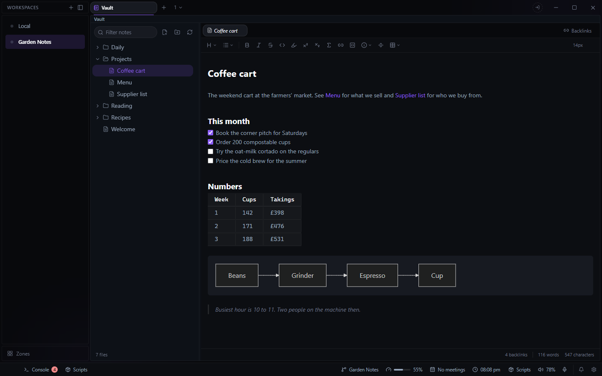

# Vault for Deck

Browse and edit a folder of markdown notes, such as an Obsidian vault, as live-preview markdown
with wikilinks and backlinks. Open it from the **+** beside your tabs and choose **Vault**.

Needs: a folder of notes, chosen in the tab the first time or in Settings > Plugins > Vault. An
Obsidian vault works as it is.

## Notes

- **Live preview.** The markdown is styled in place as you type, in the same editor Deck uses
  for a `.md` file, with its formatting toolbar, and Mermaid diagrams drawn. Notes save as you
  type and when you close them. Ctrl+wheel changes the text size.
- **Tabs.** A single click opens a note in a preview tab that the next click replaces; a
  double-click, or an edit, keeps it.
- **Wikilinks.** Typing `[[` offers the vault's notes and writes the shortest name that finds
  the note. Click a link to open its note; links resolve as Obsidian resolves them (the
  shallowest note of that name wins, `[[Note#heading|alias]]` included).
- **Backlinks.** The status bar counts the notes linking to the open one; click the count to
  list them with the line that links. Words and characters are counted beside it.
- **Embeds.** `![[image.png]]` finds the file by name anywhere in the vault.
- **Other files** open read-only: images, audio, video, PDFs and text.

## The tree

- A filter box, and buttons for a new note, a new folder and re-reading the vault.
- Right-click for new note or folder, rename, delete, Reveal in Explorer, Copy path, Copy vault
  path and Copy as wikilink. Drag a row onto a folder to move it there; open tabs follow.
- Dotfiles and dot-folders (`.obsidian`, `.git`), `node_modules`, and Syncthing's conflict
  copies are hidden.
- In a narrow pane the tree becomes a drawer over the note.

The vault folder is kept in `data\vault\vault-root.json` in Deck's config folder. Nothing from
the notes is cached: the vault is read from disk when the tab opens or you re-read it, so
Obsidian or a sync tool can write to the same folder.
